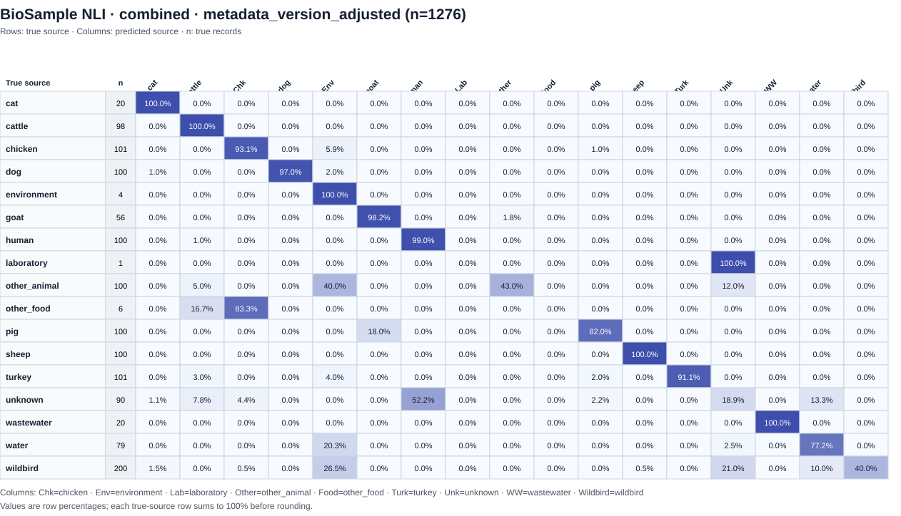
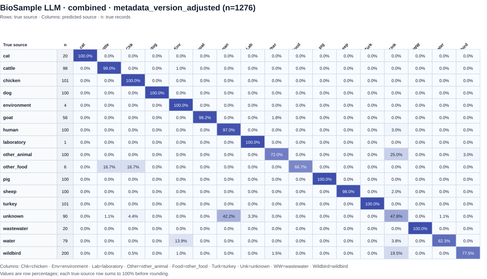
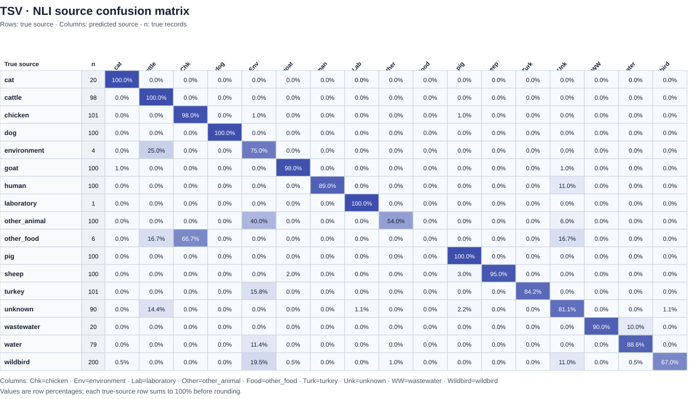
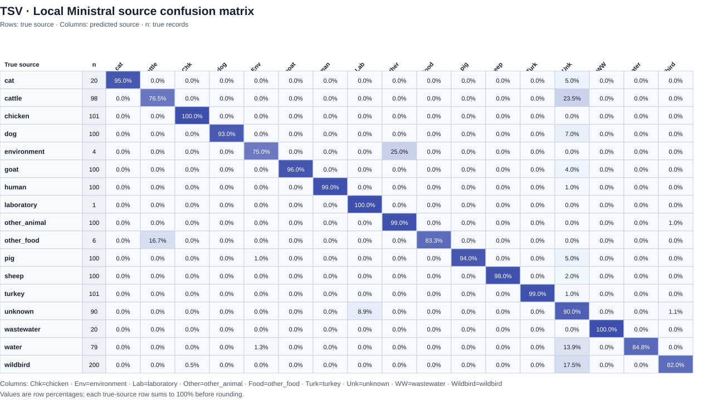
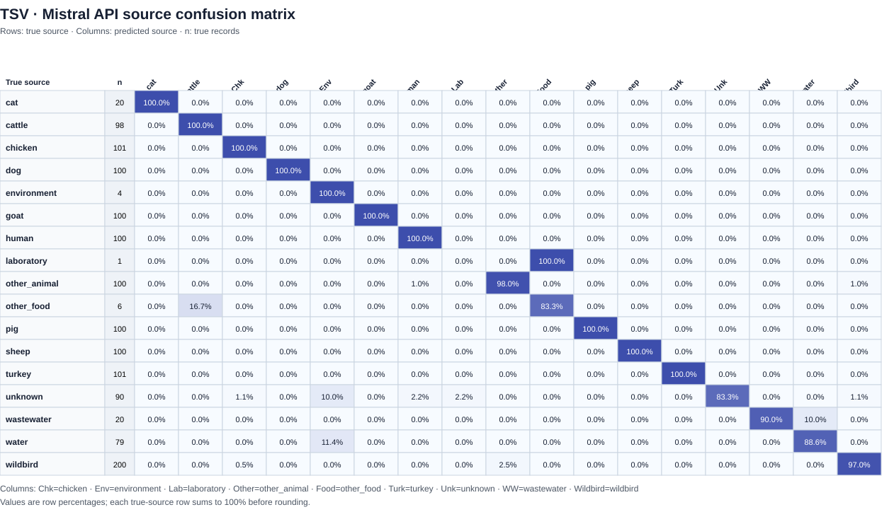
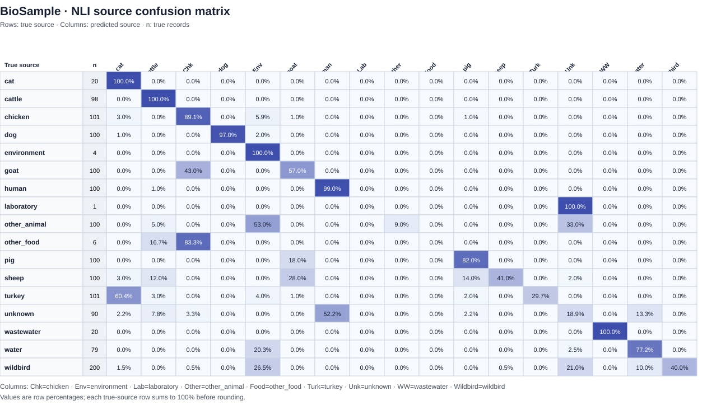
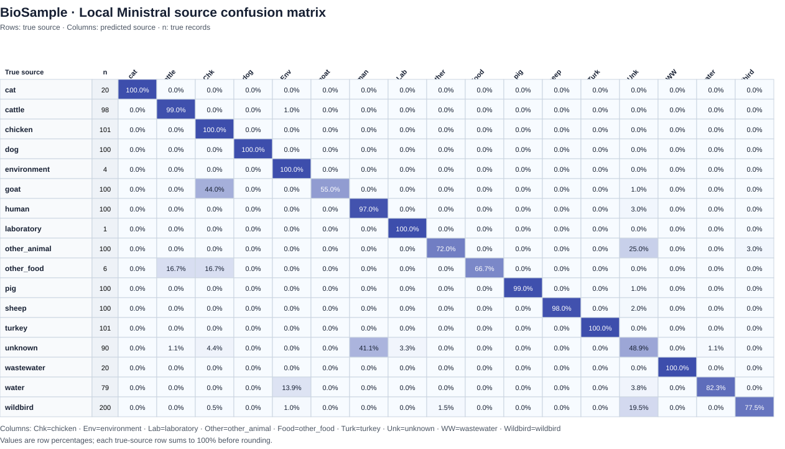
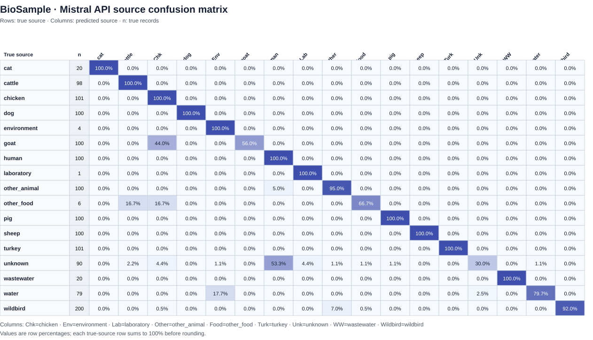

# Metadata Classification Pipeline (Zero-shot + Deterministic Parsing)

This repository contains a Python pipeline to classify biological metadata records using a combination of:

- Source/host classification with DeBERTa zero-shot NLI (default), a local Hugging Face LLM, or the Mistral API
- Deterministic parsing (for year and country)

The pipeline is designed for large-scale datasets (e.g. ENA/SRA metadata) with heterogeneous formatting.

---
## For the impatient

If you build IKEA wardrobes without ever looking at the instructions, and you are more of a try first, read later person, here is a GPU quickstart using `--method llm`:

```bash
git clone https://github.com/aldertzomer/metalyzer.git
cd metalyzer
conda env create -f environment.yml
conda activate metalyzer
# If your Linux CUDA installation needs it: conda install -c conda-forge cuda-driver-dev=12.9
export TOKENIZERS_PARALLELISM=true
python metalyzer.py --download-taxonomy taxonomy
python metalyzer.py \
  --metadata benchmark.tsv \
  --sources sources.tsv \
  --out classified.tsv \
  --id-col run_accession \
  --device 0 \
  --method llm \
  --llm-batch-size 10 \
  --taxonomy-dir taxonomy
```

Read on for NLI on CPU or GPU, other LLM options, performance, and metrics.

## Overview

Metalyzer parses year and country deterministically and classifies the source
using optional host taxonomy followed by NLI, a local LLM, or the Mistral API.
Use `--method nli|llm|mistral` to select the fallback classifier for unresolved
rows. `--skip-date` and `--skip-country` omit those stages and their output
columns.

For each metadata row, the pipeline performs:

### 1. Source classification (host taxonomy, then NLI or local LLM or Mistral)

1. If `--taxonomy-dir` is supplied, resolve explicit host taxonomy IDs or exact host names using local NCBI taxonomy, then configured operational aliases. The additional unlisted-animal rule is opt-in.
2. Unambiguous taxonomy-derived host assignments take precedence over language-model inference.
3. Only unresolved rows reach the selected backend: [DeBERTa zero-shot NLI](#nli-classifier) (`--method nli`, the default), a [local Ministral LLM](#local-ministral-classifier) (`--method llm`), or the [Mistral API](#mistral-api-classifier) (`--method mistral`).
4. NLI predictions below `--min-score` become `unknown`.


---

### 2. Year extraction (deterministic)

Extracts a 4-digit year (1905–2030) from:

- `collection_date`
- `collection_date_start`
- `collection_date_end`


Supported formats:

2019

2016-04

31-12-19

15-06-18

2007-11


Handles both:

- 19YY
  
- 20YY


---

### 3. Country normalization (deterministic)

Normalizes messy country fields such as:

USA:WY

U.S.A;USA

Canada: Calgary, Alberta

United Kingdom: Oxford

to standardized country names using:

- alias mapping
  
- pycountry
  
- controlled fallback (no full-text fuzzy matching)
  

---

## Input

### Metadata table (TSV)

Save the metadata as a tab-delimited file with a unique accession column.
Use `--id-col` to name that column; the supplied [`benchmark.tsv`](benchmark.tsv)
uses `run_accession`. Include source or host fields that can support
classification, along with date and country fields when available.

Example:

| run_accession | host | isolation_source | collection_date | country |
|---|---|---|---|---|
| ERR001 | Gallus gallus | neck skin | 2019 | USA |

For the text sent to NLI, the local LLM, and the Mistral API, Metalyzer omits
the configured ID column, `host_tax_id`, and generic `tax_id`. The first is an
identifier; deterministic taxonomy already handles `host_tax_id`; generic
`tax_id` often names the sequenced organism rather than the sample source.
The original metadata table remains available unchanged to taxonomy, date,
country, and output processing. Other metadata fields remain in the rendered
record. Values are trimmed, CR/LF and repeated whitespace become one space,
and standard HTML entities are decoded (`&amp;` becomes `&`). Punctuation,
capitalization, and field order are preserved. The usual value and record
length limits still apply.


---

### Sources file (TSV)

Put the canonical source name first, followed by human-readable hints in parentheses.
The optional `taxonomy_anchors` column holds comma-separated NCBI Taxonomy IDs
for deterministic `host_tax_id` matching. Leave it blank when no taxon safely
identifies that source; a file containing only `source` is also supported.

| source | taxonomy_anchors |
| --- | --- |
| chicken (poultry host Gallus gallus) | 9031 |
| human (human host Homo sapiens) | 9606 |
| laboratory (artificial or synthetic sequences) | 81077,32630 |

Hints help the text classifiers distinguish similar sources. Taxonomy IDs are
configuration for the deterministic matcher only; NLI, the local LLM and the
Mistral API receive only the `source` descriptions.
The current list combines waterbirds and other wild birds under `wildbird`;
there is no separate `waterbird` output class. It also includes `other_food`
for food with no identifiable animal or other listed source. A generic `food`
field alone does not justify assigning chicken, cattle, or another animal.


---

## Output

A TSV file with:

id    <source scores...>    best_hit    source_method    source_evidence    source_llm_score    nli_verification_score    year    country

Example:

|run_acc|chicken|human|cattle|best_hit|source_method|source_evidence|source_llm_score|nli_verification_score|year|country|
|-------|-------|-----|------|--------|-------------|---------------|----------------|----------------------|----|-------|
|ERR001|0.85|0.01|0.02|chicken|nli||NA|0.93|2019|United States|

- One score column per source, named using the text before the first `(` in `sources.tsv`; multi-word names are preserved
- For NLI rows, `best_hit` is the name of the source with the highest score; ties use the first source in `sources.tsv`
- In NLI mode, `--min-score` sets the minimum top score required for `best_hit`; lower-scoring rows are labelled `unknown` while their score columns are retained. The default is `0.2`.
- Full source labels, including parenthetical hints, are still used for classification
- Short source names must be nonempty, unique, and distinct from the ID, `best_hit`, `source_method`, `source_evidence`, `source_llm_score`, `nli_verification_score`, `year`, and `country` column names
- Taxonomy-derived rows use `source_method=host_tax_id` and **all source scores are `NA`**, because no NLI inference was performed. They are not artificial probabilities and are not subject to `--min-score`.
- NLI rows use `source_method=nli`, including below-threshold `unknown` calls; their `source_evidence` is blank.
- Local LLM rows use `source_method=llm` and all per-source candidate score columns are `NA`. For valid answers, `source_llm_score` is the geometric mean probability of the generated tokens forming the label the local LLM actually produced, including `unknown`. It comes from the existing generation call, with no additional model inference or comparison against other labels. It is **not a calibrated probability that the classification is correct**. A valid non-unknown answer below `--llm-min-score` becomes `unknown`, while its original numeric score and rejected label remain available as `source_llm_score` and `source_evidence=llm_low_score=<label>`. A generated `unknown` has blank evidence. If a quoted or JSON response does not allow exact label-token isolation, its score is `NA`. Malformed answers become `unknown` with `source_evidence=invalid_llm_output=...` and `source_llm_score=NA` (evidence is sanitized and truncated to 200 characters).
- Mistral API rows use `source_method=mistral` with the same `NA` score convention. `unknown` is always allowed, even when absent from the sources file. Malformed answers have `source_evidence=invalid_mistral_output=...`; request/authentication/quota failures abort instead of producing unknown labels.
- `nli_verification_score` is a separate binary NLI entailment/support score for the final assigned non-unknown source. It is `NA` for `unknown` and when `--disable-verify-source` is set.
- year as 4-digit string
- country as normalized name

Each analysis also writes a human-readable log beside its TSV: `classified.tsv`
produces `classified.tsv.log`. Version 0.2 prints the same progress and summary
messages to the terminal and records provenance in that log: command line,
local Git commit when available, Python/OS, method and model settings, input
paths, a SHA256 of `sources.tsv`, local taxonomy file paths/sizes/timestamps,
and input dimensions. The log also records classification totals and source
verification counts. LLM runs record `llm_min_score` and counts before and after
confidence filtering, including low-score calls converted to `unknown`.
Warnings appear on screen and in the log; failures exit
nonzero and leave a full Python traceback in the log. API key contents are
never logged. Logging and provenance add no columns to the classification TSV.
Check the installed release with `python metalyzer.py --version`; it exits
without analysis arguments and prints `metalyzer 0.2`.

---

### Source verification

After source classification, Metalyzer uses the same DeBERTa NLI model and
hypothesis wording as `--method nli` to test each assigned source against the
original rendered metadata. It evaluates **only one hypothesis per non-unknown
row**, using the selected source's full description from `sources.tsv`, including
its hints. The score is equivalent to zero-shot `multi_label=True` for that one
candidate. This does not rerun the full NLI classification or compare the
assigned source with alternatives. It applies to `host_tax_id`, `nli`, `llm`,
and `mistral` assignments alike.

Verification runs by default. Pass `--disable-verify-source` to skip it and
write `NA` in `nli_verification_score` for every row. An `unknown` assignment
is never scored. On NLI runs, the classifier and verifier share the loaded NLI
pipeline. On LLM and Mistral API runs, verification loads the NLI model for
non-unknown assignments, adding model memory and inference time.

---

## Installation

Requirements:

- Python ≥ 3.10
- Conda environment recommended

```bash
git clone https://github.com/aldertzomer/metalyzer.git
cd metalyzer
```

For an NVIDIA CUDA GPU, install from Conda:

```bash
conda env create -f environment.yml
conda activate metalyzer
```

`environment.yml` selects conda-forge's `pytorch-gpu`; Conda resolves the CUDA
runtime dependencies for the target system. A compatible NVIDIA driver is
required. The file lists application dependencies rather than fixing every
platform-specific package build or a user-specific installation path.

### CPU-only installation

For a machine without CUDA, create the CPU environment instead:

```bash
conda env create -f environment-cpu.yml
conda activate metalyzer-cpu
```

`environment-cpu.yml` explicitly selects conda-forge's `pytorch-cpu`
metapackage and therefore does not install CUDA, FlashAttention, or Triton.
Run the pipeline with `--device -1`.

Both specifications use Python 3.11, Transformers 5.x, PyTorch 2.x,
`mistral-common>=1.8.6`, `accelerate`, and the SentencePiece/Protobuf tokenizer
dependencies. They are environment specifications,
not exact lockfiles. Taxonomy dump parsing and downloading use the Python
standard library. The pipeline and tests use the dependencies listed in these
environments; the taxonomy feature requires no additional packages.
The API Mistral module requires the optional `mistralai` v2 SDK. It is loaded only
when unresolved rows need API inference; NLI, local LLM and taxonomy-only runs
do not require it.

On the Linux GPU server used for the local Ministral test, the CUDA build also
required `cuda-driver-dev=12.9` from conda-forge. Install it where needed with
`conda install -c conda-forge cuda-driver-dev=12.9` if needed; it is omitted
from the cross-platform environment files because CPU and Windows installations
do not use it.

To update an existing environment, use the matching command:

```bash
conda env update -n metalyzer -f environment.yml
# Or, for the CPU environment:
conda env update -n metalyzer-cpu -f environment-cpu.yml
```

An update may retain packages from an older environment. Create a fresh CPU
environment when switching from a CUDA installation.

---

## Usage

### Optional local NCBI host taxonomy

Download the [official NCBI taxonomy dump](https://ftp.ncbi.nlm.nih.gov/pub/taxonomy/)
once (network access occurs only when this command is explicitly requested):

```bash
python metalyzer.py --download-taxonomy taxonomy
```

This fetches `https://ftp.ncbi.nlm.nih.gov/pub/taxonomy/taxdump.tar.gz` and
installs `nodes.dmp`, `names.dmp`, and `merged.dmp` in `taxonomy/`. You can
also download and unpack these three files manually. Run the download command
again to refresh the local data; retain a copy of the dump for reproducible runs.

```bash
python metalyzer.py --metadata benchmark.tsv --sources sources.tsv \
  --out classified.tsv --id-col run_accession \
  --taxonomy-dir taxonomy --device -1 --batch-size 10
```

Use `--device 0` for GPU execution. Normal taxonomy lookup is entirely local:
files load once and lineages are cached. Numeric `host_tax_id` and `host_taxid`
are aliases. When a numeric host ID cannot assign a source, exact `host` or
`host_scientific_name` values can resolve through the same taxonomy anchors.
Genuine `original_attributes.host scientific name` aliases are also considered,
without changing the raw dataframe. Generic `organism` / `tax_id`, titles,
descriptions and isolation-source text never provide deterministic host evidence.
Numeric strings, integral decimal values such as `9940.0`, quoted IDs, and
obsolete IDs in `merged.dmp` are supported. Names match case-insensitively after
whitespace normalization, with exact scientific names preferred over uniquely
mapped NCBI common names/synonyms. Ambiguous names are rejected; there is no
fuzzy or substring matching. Distinct batch host names are resolved in one
streaming pass through `names.dmp`, and results are cached without a second
complete taxonomy-name index. Missing or invalid evidence falls back to the
selected text classifier. Omitting `--taxonomy-dir`, or supplying unreadable/malformed files,
produces a warning and uses the selected text classifier for every row.

The `taxonomy_anchors` column in `sources.tsv` controls these assignments.
Each ID maps that taxon and all its descendants to the row's source, regardless
of taxonomic rank. For each valid `host_tax_id`, Metalyzer normalizes merged IDs
and walks its lineage from the most specific taxon toward the root; the first
configured anchor wins. Thus a species anchor such as chicken (`9031`) can
override a broader Aves (`8782`) anchor, and a cat (`9685`) anchor can override
Carnivora (`33554`) in a custom vocabulary. At startup, configured anchors are
checked against the loaded taxonomy dump. Obsolete IDs are normalized and
logged; nonexistent IDs, broken lineages, or a normalized anchor assigned to
multiple sources stop the run with a configuration error. The log reports the
configured, valid, merged, invalid, and conflicting anchor counts. Blank
anchors or no matching lineage for a valid host fall back to the selected
classifier. The generic sample/pathogen `tax_id` is intentionally never source
evidence, since it often identifies the sequenced organism instead of its host.

Numeric evidence takes priority when numeric and textual hosts map to the same
configured source. If one route cannot resolve a configured source, the other
can be used. Different configured source classes from numeric aliases or host
name fields are logged as conflicts and left for the normal model fallback.
Incompatible resolved host taxa are also rejected under broad custom anchors;
ancestor/descendant host evidence remains compatible.
Names in unconfigured lineages also fall back: `Sus scrofa` does not become
domestic pig merely because its descendant `Sus scrofa domesticus` is anchored;
a duck does not become chicken or wildbird without a matching configured anchor.
No numeric host ID is fabricated in the input dataframe.

The repository file configures domestic pig (`9825`), chicken (`9031`), turkey
(`9103`), cattle (`9913`), sheep (`9940`), goat (`9925`), human (`9606`), dog
(`9615`), and cat (`9685`). It also configures the environmental-samples node
`1936016` and artificial/synthetic sequence nodes `81077,32630`. Descendants
of a configured environmental node inherit its source; this applies to soil,
marine or air metagenome nodes only when they actually fall below that anchor
in the supplied NCBI dump. Ordinary organism taxids, such as *E. coli* `562`,
do not imply `laboratory`: a laboratory strain may have come from any source.
The broad Metazoa anchor is left blank for `other_animal` in the repository file
because it would also absorb birds and animal sources whose ecological or food
context taxonomy alone cannot establish. Custom source files can use higher-level
anchors when their classes make that inheritance appropriate. These IDs are
never passed to NLI or generative models; their source descriptions remain
unchanged.

For a sheep host, the output looks like this (all other source scores are also `NA`):

```text
run_accession   chicken turkey  pig cattle  sheep   ... best_hit source_method   source_evidence
SRR17929619     NA      NA      NA  NA      NA      ... sheep    host_tax_id     host_tax_id=9940; Ovis aries
```

Input order, year/country extraction, and NLI score column names are preserved.
Each run reports taxonomy calls, selected classifier calls, and its `unknown` calls.
Numeric assignments use `source_method=host_tax_id`; name-derived assignments
use `source_method=host_name`, for example
`host=Meleagris gallopavo; taxid=9103; Meleagris gallopavo`. Both routes count
as deterministic assignments and have `source_llm_score=NA`. Logs distinguish
numeric assignments, exact-name assignments, conflicts/ambiguities, and rows
continuing to the selected model. Conflicts/ambiguities are a subset of fallback
rows. The output schema, model prompts, confidence thresholds and verification
behavior are unchanged.
LLM runs also report the number of invalid model outputs.
If all hosts resolve, the fallback classifier is not loaded. The NLI verifier
still loads for those assignments unless `--disable-verify-source` is set.

### BioSample host terminology and unlisted animals

Current NCBI BioSamples often provide a scientific name in `host` without a
numeric host taxonomy ID. Metalyzer first uses explicit `host_tax_id` / `host_taxid`,
then exact scientific names, then uniquely resolved NCBI common names/synonyms.
These paths use local `names.dmp`, merged IDs and the configured source anchors.

The optional `host_aliases` column in `sources.tsv` adds operational host
terminology. Multiple aliases are separated by semicolons, for example
`canine; companion dog`. Matching is case-insensitive after whitespace
normalization and requires the entire explicit host field. `Porcine` may map
to pig; `porcine-associated wastewater` does not. Aliases never use titles,
isolation sources, generic organism names or pathogen taxids. Source descriptions
and anchors remain unchanged, and older source files without aliases still work.
Blank cells mean no aliases; empty entries inside a list, malformed values,
missing-value placeholders and aliases shared by different classes are rejected
before model loading.

The supplied aliases are canine→dog, porcine→pig, ovine→sheep, caprine→goat,
feline→cat and bovine→cattle. These are **explicit operational assumptions**:
canine and porcine do not identify domestic species taxonomically. An alias
cannot override incompatible numeric or resolved named taxa, including wild
canids or `Sus scrofa` outside the domestic-pig anchor. Such conflicts continue
to the normal model fallback. Exact NCBI assignment remains primary; `Bovine`
continues to use its NCBI name match. Disable all source aliases for strict
taxonomy-only host resolution with `--disable-host-aliases`.

`--other-animal-taxonomy` independently opts in to an additional `other_animal`
assignment for unambiguously named animal species/subspecies outside configured
source lineages. It requires that category in the source vocabulary, excludes
birds, and rejects taxa that are ancestors of any configured anchor. Thus
Metazoa, Mammalia, Canidae, `Sus scrofa`, goose, duck and Columbidae retain fallback
under the supplied vocabulary. No broad Metazoa anchor is added. This rule is
**disabled by default**: a resolved species does not establish ecological or
domestication context, and the audit includes one wild-goat/reference-goat
disagreement. The separate option makes its impact auditable.

| Evidence route | `source_method` | Example `source_evidence` |
|---|---|---|
| Supplied numeric host ID | `host_tax_id` | `host_tax_id=9940; Ovis aries` |
| Exact NCBI host name | `host_name` | `host=Meleagris gallopavo; taxid=9103; Meleagris gallopavo` |
| Configured operational descriptor | `host_alias` | `host=Porcine; configured_host_alias=pig` |
| Opt-in specific unlisted animal | `host_other_animal` | `host=alpaca; taxid=30538; Vicugna pacos; specific_unlisted_nonbird_animal` |

All deterministic routes have `source_llm_score=NA`, bypass source-model
classification and retain normal NLI verification. Raw metadata and the TSV
schema are unchanged; aliases never fabricate a numeric host ID. Logs distinguish
scientific/common name routes, aliases, unlisted animals, conflicts and fallback.
Model prompts, thresholds, `--llm-min-score 0.75`, date/country extraction and
BioSample storage are unchanged.

The [four-configuration CPU audit](benchmark_smoke/host_terminology_audit/summary.tsv)
uses the same 1,320 requests and existing accession mapping:

| Configuration | Numeric ID | Scientific name | Common/synonym | Alias | Other animal | Model fallback |
|---|---:|---:|---:|---:|---:|---:|
| Current exact taxonomy | 1 | 295 | 106 | 0 | 0 | 918 |
| Plus aliases (default) | 1 | 295 | 106 | 117 | 0 | 801 |
| Plus opt-in other animal | 1 | 295 | 106 | 0 | 42 | 876 |
| Combined | 1 | 295 | 106 | 117 | 42 | 759 |

These are assignment counts; a taxonomically resolved name may still need the
model. All four configurations have zero ambiguous/conflicting hosts in this
benchmark. The aliases newly assign Canine 22, Porcine 39, Ovine 35, Caprine 20
and Feline 1, all consistent with existing references. All 83 Bovine records
still use `host_name`. The 42 additional animals include five alpacas; 41 match
the references. `SAMN08235377` (`Capra aegagrus`, wild goat) instead receives
`other_animal`, while its reference says goat. This does not justify a
species-specific production exception or enabling the broader rule by default.
See [all per-record evidence](benchmark_smoke/host_terminology_audit/audit.tsv)
and [new disagreements](benchmark_smoke/host_terminology_audit/combined_new_disagreements.tsv).

Reproduce the audit and new local GPU benchmarks (no paid API):

```bash
python benchmark_smoke/audit_host_terminology.py --taxonomy-dir /path/to/taxonomy
python benchmark_smoke/run_host_terminology_benchmarks.py \
  --taxonomy-dir /path/to/taxonomy --other-animal-taxonomy
```

The benchmark explicitly enables the opt-in rule to measure the combined
configuration. Omit that flag and choose a separate `--out-dir` to benchmark
the default alias-only configuration. Earlier outputs and reference labels
remain untouched.

#### New full BioSample GPU benchmarks

The combined configuration was run on all 1,320 requests with a 16 GB
RTX 4070 Ti SUPER, cached weights and offline model loading. NLI batch size
was 64, Ministral batch size 1, NLI cutoff 0.2 and local LLM cutoff 0.75,
with ordinary NLI verification, date and country extraction enabled. The
additional `other_animal` rule was explicitly enabled for this experiment;
it remains disabled for ordinary runs. No paid Mistral API run was made.

| Method / version | Original accuracy (1,320) | Original assigned precision | Adjusted accuracy (1,276) | Adjusted assigned precision |
|---|---:|---:|---:|---:|
| NLI, old saved | 60.98% | 64.43% | 63.01% | 66.75% |
| NLI, new combined | 72.88% | 75.84% | 75.39% | 78.62% |
| Ministral, old saved | 85.83% | 90.60% | 88.79% | 94.04% |
| Ministral, new combined | 85.83% | 90.46% | 88.79% | 93.88% |

Assigned precision excludes predicted `unknown`; accuracy includes every scored
record, including reference `unknown`. Original scoring uses unchanged labels.
Adjusted scoring excludes only the 44 live-verified CAGED run/BioSample pairs:
the May 2025 ENA snapshot says goat, while current BioSample has chicken and
an 18 June 2025 update. These are reference-version differences, not demonstrated
model failures. The separate 41 documented human-evidence/reference-unknown
records remain scored and visible; no reference was relabelled.

All 759 records that still required a model received the same labels as their
old saved predictions, for both backends. The changes therefore occurred on
deterministically assigned records. Aliases corrected 21 old NLI decisions and
two old Ministral decisions, with no new errors. The additional animal rule
corrected 34 NLI decisions but changed the wild-goat record from goat to
`other_animal`; Ministral had already correctly matched the other 41 references.
Ministral's two alias gains were offset by that wild-goat disagreement and
`SAMEA7632583`, where explicit `Homo sapiens` correctly triggers `host_name`
but the unchanged reference says `unknown`. Its accuracy is consequently flat,
with a slight precision decrease as more records receive assignments.

On the adjusted denominator, deterministic-route precision is: numeric IDs
100% (1/1), scientific names 96.41% (242/251), common names/synonyms 98.11%
(104/106), aliases 100% (117/117), and additional animals 97.62% (41/42).
This small benchmark supports keeping the supplied aliases enabled but does
not establish their validity for every veterinary dataset. The broader animal
rule stays opt-in. Default alias-only coverage is audited above; the full new
model metrics in this table measure the combined configuration.

| New run | Source-model rows | Source-model stage, including load | NLI verification stage | Total run |
|---|---:|---:|---:|---:|
| NLI | 759 | 175.8 s | 20.1 s | 414.2 s |
| Ministral | 759 | 331.2 s | 21.3 s | 570.5 s |

These are measured wall-clock stage times, including tokenization/inference and
weight loading, rather than GPU kernel-only times. Totals also include local
Parquet lookup and taxonomy loading. Source-model rows fall by 561 (42.5%)
versus the saved runs' 1,320, and by 159 (17.3%) versus the previous exact-name
resolver's 918 pending records. Verification still runs on final non-unknown
assignments. The old total run times were 539.9 s (NLI) and 785.9 s (Ministral);
hardware/cache differences mean these are not a controlled speed comparison.

- Fresh normal TSV outputs: [NLI](benchmark_smoke/host_terminology_benchmark/benchmark_biosample_nli_host_terminology.tsv), [Ministral](benchmark_smoke/host_terminology_benchmark/benchmark_biosample_llm_host_terminology.tsv).
- [All source metrics](benchmark_smoke/host_terminology_benchmark/evaluation/summary.tsv), [pathway metrics](benchmark_smoke/host_terminology_benchmark/evaluation/pathway_metrics.tsv), [timing](benchmark_smoke/host_terminology_benchmark/evaluation/performance.tsv), and [per-record changes](benchmark_smoke/host_terminology_benchmark/evaluation/prediction_comparison.tsv).
- Retained reference-unknown/human-evidence records: [NLI](benchmark_smoke/host_terminology_benchmark/evaluation/nli_reference_unknown_human_evidence.tsv), [Ministral](benchmark_smoke/host_terminology_benchmark/evaluation/llm_reference_unknown_human_evidence.tsv).





Original 1,320-record confusion matrices: [NLI](benchmark_smoke/host_terminology_benchmark/evaluation/original/nli_confusion_percent.svg), [Ministral](benchmark_smoke/host_terminology_benchmark/evaluation/original/llm_confusion_percent.svg).
Both evaluation directories also contain absolute-count SVGs and TSVs.
Reproduce scoring after both full runs finish:

```bash
python benchmark_smoke/evaluate_host_terminology.py
```

### NLI classifier

`--method nli` is the default source classifier. It runs the
`MoritzLaurer/deberta-v3-large-zeroshot-v2.0` model locally, without an API key.
When taxonomy is enabled, host assignments take precedence and only unresolved
rows reach NLI. The model loads when inference or source verification needs it.
It runs on a CUDA GPU or CPU.

For each unresolved row, Metalyzer turns the relevant metadata into a readable
record, for example:

```text
host: Gallus gallus; isolation source: neck skin; country: USA
```

The model compares that record with the full source descriptions in
`sources.tsv` using a biological host or environmental source hypothesis. It
scores every candidate and assigns the highest-scoring source. If its score is
below `--min-score` (default `0.2`), the result is `unknown` while the candidate
scores remain in the output.

```bash
export TOKENIZERS_PARALLELISM=true
```

```bash
python metalyzer.py \
  --metadata benchmark.tsv \
  --sources sources.tsv \
  --out classified.tsv \
  --id-col run_accession \
  --method nli \
  --device 0 \
  --batch-size 64 \
  --min-score 0.2 \
  --taxonomy-dir taxonomy
```

Use `--device 0` for the first GPU (the default), or another nonnegative GPU
index. GPU execution requires a CUDA-enabled PyTorch installation.

For CPU execution, use `--device -1`. For example, to run the benchmark:

```bash
python metalyzer.py --metadata benchmark.tsv --sources sources.tsv --out classified.tsv --id-col run_accession --device -1 --batch-size 10
```

NLI CPU execution explicitly uses float32 to avoid slow float16 inference.
GPU execution uses the model checkpoint's precision (`dtype="auto"`).

### Local Ministral classifier

`--method llm` selects local generative classification with
[`mistralai/Ministral-3-8B-Instruct-2512`](https://huggingface.co/mistralai/Ministral-3-8B-Instruct-2512)
by default. Transformers downloads the tokenizer and weights on first use and
reuses the standard Hugging Face cache on subsequent runs. Inference runs on
your machine; no API key is required. The existing environments contain the
required dependencies.

Taxonomy still takes precedence: only unresolved `host_tax_id` rows reach the
LLM. The LLM does not load if taxonomy resolves every row. With verification
enabled, DeBERTa also loads to score the final non-unknown assignments. The
natural-language metadata representation and
deterministic year/country processing are shared with NLI.

The same `sources.tsv` supplies canonical labels and their full descriptions.
The LLM may also answer `unknown` when source evidence is insufficient; this
does not add an `unknown` score column unless that source is in your file.
The prompt tells the model that field names alone are not source evidence and
that ambiguous or absent source values should map to `unknown`. These rules
also apply to the separate Mistral API method.
All per-source candidate score columns are `NA`. Valid LLM decisions also have
`source_llm_score`, as described in [Output](#output). The default
`--llm-min-score 0.75` is a quality-control abstention threshold. A low score
means the local generative model produced its selected label with relatively
weak generation confidence; it does not mean the source is biologically
impossible or intrinsically incorrect. A human may still assign it correctly
from the same metadata. Metalyzer converts valid local LLM source calls below
the threshold to `unknown` to favor precision and downstream dataset quality,
deliberately sacrificing some correct calls. The original score and rejected
label remain available for audit. NLI verification scores only the final
non-unknown source, so an abstention has `nli_verification_score=NA`.
Choose the threshold based on whether coverage or precision matters more.
`--min-score` applies only to NLI; in LLM mode it prints an informational
message and does not affect predictions.

```bash
# Default conservative threshold; equivalent to adding --llm-min-score 0.75
python metalyzer.py ... --method llm
python metalyzer.py ... --method llm --llm-min-score 0.75

# Greater coverage
python metalyzer.py ... --method llm --llm-min-score 0.5

# Effectively disable LLM confidence filtering
python metalyzer.py ... --method llm --llm-min-score 0
```

```bash
python metalyzer.py \
  --metadata benchmark.tsv \
  --sources sources.tsv \
  --out classified_ministral.tsv \
  --id-col run_accession \
  --taxonomy-dir taxonomy \
  --method llm \
  --llm-model mistralai/Ministral-3-8B-Instruct-2512 \
  --device 0 \
  --llm-batch-size 1
```

Use `--device 0` for the first CUDA GPU, another nonnegative index for that
specific GPU, or `--device -1` for CPU. An unavailable GPU causes a clear error
instead of silently switching devices. Omit `--taxonomy-dir taxonomy` if you
have not downloaded taxonomy.

CPU example:

```bash
python metalyzer.py --metadata benchmark.tsv --sources sources.tsv \
  --out ministral_cpu.tsv --id-col run_accession \
  --method llm --llm-model mistralai/Ministral-3-8B-Instruct-2512 \
  --device -1 --llm-batch-size 1 --taxonomy-dir taxonomy
```

For a quick test, add `--limit 10` to either command. `--limit` also works with
NLI and selects the first N metadata rows before classification.

`--llm-model` accepts another compatible Ministral 3 checkpoint;
`--llm-revision` optionally pins both tokenizer and weights to a specific
Hugging Face revision. Models are never substituted automatically. Generation
is greedy and defaults to `--llm-max-new-tokens 16`. The Mistral tokenizer
formats and pads batches of chat conversations directly.

`--llm-batch-size` defaults to 1 independently of NLI's `--batch-size 64`.
The LLM retains checkpoint precision (`dtype="auto"`) on both CPU and GPU and
loads with `low_cpu_mem_usage=True`. GPU loading uses `device_map` for the
requested GPU and requires `accelerate`; the model's Mistral tokenizer requires
`mistral-common`. Mistral's [model card](https://huggingface.co/mistralai/Ministral-3-8B-Instruct-2512)
states the FP8 model can fit in 12 GB of VRAM, or less with further quantization.
Actual memory for this Transformers pipeline also includes activations,
generation cache, loading overhead, and other processes. The supplied test ran
on a 16 GB GPU server without recording peak memory, so a 12 GB fit for this
exact command has not been verified. CPU execution may be slow and may need
substantially more memory.

### Mistral API classifier

`--method mistral` uses [`modules/mistral.py`](modules/mistral.py) with the
standard pipeline inputs and output columns. Taxonomy still takes precedence;
only unresolved rows are sent to the Mistral API. API calls may incur charges.
Date and country extraction remain local.
The API module itself does not load PyTorch, Transformers, or local model
weights; the default source verification step does load DeBERTa for non-unknown
assignments. Use `--disable-verify-source` when running without local NLI weights.

Install the optional SDK in your active environment:

```bash
conda install -c conda-forge 'mistralai>=2,<3'
```

When API access is available, start with a small run:

```bash
python metalyzer.py \
  --metadata benchmark.tsv \
  --sources sources.tsv \
  --out benchmark_mistral_modular.tsv \
  --id-col run_accession \
  --method mistral \
  --api-key-file ~/mistral.key \
  --mistral-concurrency 1 \
  --mistral-retries 0 \
  --limit 10
```

Add `--taxonomy-dir taxonomy` for a taxonomy-enabled benchmark run. The key file accepts
either the raw key or `MISTRAL_API_KEY=...` (optionally quoted). It is read only
when API requests are needed and is never included in metadata or output.

As with the local LLM, **`unknown` is always an allowed answer**. It is added
to both the prompt and the JSON schema when missing from your source list.
There is no need to edit `sources.tsv`, and no extra `unknown` score column
appears unless your file explicitly includes that source. An explicit unknown
answer has blank evidence. Invalid JSON, unexpected labels or missing responses
become unknown with sanitized `invalid_mistral_output=...` evidence (at most
200 characters after the prefix), without another paid request.

The schema follows the [official Mistral structured-output SDK example](https://github.com/mistralai/client-python/blob/main/examples/mistral/chat/structured_outputs_with_json_schema.py).
Output includes `best_hit`, `source_method=mistral`, `source_evidence`, `year`
and `country`, with all candidate scores `NA`. `--min-score` has no effect.
`--device`, `--batch-size`, and `--llm-*` configure the local backends only.

| Option | Default | Meaning |
|---|---|---|
| `--mistral-model` | `mistral-small-latest` | Model sent to the API; choose a fixed model ID for reproducibility |
| `--mistral-concurrency` | `8` | Maximum concurrent requests/worker tasks |
| `--mistral-retries` | `5` | Additional attempts for timeouts or HTTP 408/429/500/502/503/504 |
| `--mistral-timeout` | `60` | Seconds per request attempt |
| `--mistral-random-seed` | `12345` | Seed sent to Mistral |
| `--mistral-max-tokens` | `32` | Maximum generated tokens per response |
| `--mistral-progress-every` | `10` | Print progress after this many completed rows |

Retries use capped exponential backoff; SDK retries are disabled to keep the
attempt limit predictable. Authentication errors and other permanent failures
stop immediately. Exhausted retries, including quota/rate-limit errors, stop
the run and cancel remaining workers; they never become classification labels.
The output file is written only after the full run succeeds, so API failures
leave an existing output file untouched. Completed API calls may still be billed;
this module does not checkpoint/resume partial runs.

Validation uses mocked API responses, including concurrency, timeouts, retries,
taxonomy precedence and output serialization. The saved API benchmark below
reports classification accuracy for a complete run.

## Benchmark results

The six full source-classification benchmarks below were rerun on 12 October 2026
using the reordered [metadata](benchmark.tsv) and
[accession list](benchmark_accessions.tsv), with 1,320 records and
1,319 distinct BioSamples. All runs loaded the same local NCBI taxonomy
and validated the 12 anchors configured in [sources.tsv](sources.tsv).

`benchmark_accessions.tsv` contains sequencing run IDs. These were mapped to
BioSample IDs using `sample_accession` in `benchmark.tsv`; the order and
duplicate BioSample request were preserved. BioSample metadata came exclusively
from the local indexed Parquet repository. It was not supplemented with TSV
metadata. The [run-to-BioSample mapping](benchmark_smoke/six_method_evaluation/accession_mapping.tsv)
is retained for reproducible evaluation.

Only source labels are scored against `final_species` in
[benchmark_true_labels.tsv](benchmark_true_labels.tsv). Truth-file order does not
affect matching: TSV outputs join by `run_accession`; BioSample outputs join
through the accession mapping, preserving repeated requests. Every run was
checked for complete coverage. Country, year, LLM confidence and NLI verification
scores are not scoring targets here.

NLI uses `--min-score 0.2`; local Ministral uses `--llm-min-score 0.75`.
Mistral API uses `mistral-small-latest`, seed 12345, and the default API settings.
All methods retain normal NLI source verification, date/country extraction,
run logs, and TSV output. API results reflect the service available on the run date.

| Input | Method | Correct / total | Accuracy | Assigned precision | Unknown | Taxonomy calls |
|---|---|---:|---:|---:|---:|---:|
| TSV | [NLI](benchmark_nli.tsv) | 1137 / 1320 | 86.14% | 88.23% | 114 | 215 |
| TSV | [Local Ministral](benchmark_llm.tsv) | 1215 / 1320 | 92.05% | 98.69% | 171 | 215 |
| TSV | [Mistral API](benchmark_mistral_api.tsv) | 1284 / 1320 | 97.27% | 97.11% | 75 | 215 |
| BioSample | [NLI](benchmark_biosample_nli.tsv) | 805 / 1320 | 60.98% | 64.43% | 97 | 0 |
| BioSample | [Local Ministral](benchmark_biosample_llm.tsv) | 1133 / 1320 | 85.83% | 90.60% | 118 | 0 |
| BioSample | [Mistral API](benchmark_biosample_mistral_api.tsv) | 1174 / 1320 | 88.94% | 88.85% | 29 | 0 |

Accuracy includes correct `unknown` predictions. Assigned precision excludes
predictions of `unknown`. Enabling taxonomy only resolves records with a usable
`host_tax_id`; the taxonomy-call column reports actual deterministic assignments.
Input modes differ in metadata content and availability of host taxonomy IDs,
so these results compare the complete pipelines on their respective inputs.

Rows in each confusion matrix are true sources; columns are predicted sources.
The embedded figures show row percentages. Absolute-count figures and per-source
recall/precision tables are linked below. All source metrics are also available
in the [six-run summary](benchmark_smoke/six_method_evaluation/summary.tsv).

The [BioSample error-analysis report](benchmark_smoke/biosample_diagnostics/report.md)
examines source-data conflicts, reference-unknown records with explicit source
evidence, host taxonomy availability, and controlled NLI recognition tests.

The table and figures above/below retain the complete original 1,320-record
evaluations of the saved predictions. The new host-name resolver is audited
separately before any expensive model rerun:

```bash
python benchmark_smoke/audit_host_taxonomy.py \
  --taxonomy-dir /home/zomer007/metalyzer/taxonomy
```

This CPU-only command reads the local BioSample store, reports exact host-name
and numeric-ID resolution, checks conflicts, and writes an audit under
`benchmark_smoke/host_name_audit/`. It does not run NLI, Ministral or the API,
fabricate input taxonomy IDs, replace predictions, or change reference labels.

The [complete offline audit](benchmark_smoke/host_name_audit/README.md) found
2 usable numeric host IDs, 479 exact scientific-name matches, and 616
unambiguous name matches including common names/synonyms. There were 704
unresolved/missing names and no ambiguous names or numeric/textual conflicts.
Only configured source lineages bypass classification: 1 numeric assignment
plus 401 host-name assignments gives **402 deterministic records**, leaving
**918 records for model fallback**. The existing model benchmark results remain
historical until a complete rerun of the updated pipeline.

It also scores the existing six prediction files twice: **original evaluation**
(all 1,320 records) and **metadata-version-adjusted evaluation** (1,276 records).
Only the exact 44 run/BioSample pairs in
[`goat_host_conflicts.tsv`](benchmark_smoke/biosample_diagnostics/goat_host_conflicts.tsv)
are excluded from the adjusted denominator. Validation checks old ENA
`Capra hircus` evidence against current BioSample `Gallus gallus` and
`ifsac_category=chicken`, including the 18 June 2025 update date in the live audit.
The historical ENA export is the AllTheBacteria May 2025 snapshot. Production
classification has no exceptions for these records: `SAMN37735409` resolves to
chicken from its current host name. The separate 41 reference-unknown/human-evidence
cases are not excluded or relabeled. The existing error-analysis report remains
a historical report of the earlier resolver.

For adjusted evaluation of other saved predictions, without changing them:

```bash
python benchmark_smoke/evaluate_local_backends.py \
  --only-predictions --prediction benchmark_biosample_llm.tsv best_hit \
  --accession-mapping benchmark_smoke/six_method_evaluation/accession_mapping.tsv \
  --conflicts benchmark_smoke/biosample_diagnostics/goat_host_conflicts.tsv \
  --out-dir benchmark_smoke/metadata_version_evaluation
```

Original and adjusted metrics/confusion tables are written into separate
subdirectories. Taxonomy counts include both `host_tax_id` and `host_name`.

### TSV · NLI benchmark

[](assets/benchmark-tsv-nli-confusion-percent.svg)

[Absolute counts](assets/benchmark-tsv-nli-confusion-absolute.svg) · [Per-source metrics](benchmark_smoke/six_method_evaluation/benchmark_nli_per_class.tsv) · [Confusion counts TSV](benchmark_smoke/six_method_evaluation/benchmark_nli_confusion_counts.tsv)

### TSV · Local Ministral benchmark

[](assets/benchmark-tsv-llm-confusion-percent.svg)

[Absolute counts](assets/benchmark-tsv-llm-confusion-absolute.svg) · [Per-source metrics](benchmark_smoke/six_method_evaluation/benchmark_llm_per_class.tsv) · [Confusion counts TSV](benchmark_smoke/six_method_evaluation/benchmark_llm_confusion_counts.tsv)

### TSV · Mistral API benchmark

[](assets/benchmark-tsv-mistral-api-confusion-percent.svg)

[Absolute counts](assets/benchmark-tsv-mistral-api-confusion-absolute.svg) · [Per-source metrics](benchmark_smoke/six_method_evaluation/benchmark_mistral_api_per_class.tsv) · [Confusion counts TSV](benchmark_smoke/six_method_evaluation/benchmark_mistral_api_confusion_counts.tsv)

### BioSample · NLI benchmark

[](assets/benchmark-biosample-nli-confusion-percent.svg)

[Absolute counts](assets/benchmark-biosample-nli-confusion-absolute.svg) · [Per-source metrics](benchmark_smoke/six_method_evaluation/benchmark_biosample_nli_per_class.tsv) · [Confusion counts TSV](benchmark_smoke/six_method_evaluation/benchmark_biosample_nli_confusion_counts.tsv)

### BioSample · Local Ministral benchmark

[](assets/benchmark-biosample-llm-confusion-percent.svg)

[Absolute counts](assets/benchmark-biosample-llm-confusion-absolute.svg) · [Per-source metrics](benchmark_smoke/six_method_evaluation/benchmark_biosample_llm_per_class.tsv) · [Confusion counts TSV](benchmark_smoke/six_method_evaluation/benchmark_biosample_llm_confusion_counts.tsv)

### BioSample · Mistral API benchmark

[](assets/benchmark-biosample-mistral-api-confusion-percent.svg)

[Absolute counts](assets/benchmark-biosample-mistral-api-confusion-absolute.svg) · [Per-source metrics](benchmark_smoke/six_method_evaluation/benchmark_biosample_mistral_api_per_class.tsv) · [Confusion counts TSV](benchmark_smoke/six_method_evaluation/benchmark_biosample_mistral_api_confusion_counts.tsv)

Regenerate all six runs, metrics and figures from the repository root:

```bash
python benchmark_smoke/run_six_benchmarks.py
python benchmark_smoke/publish_six_benchmarks.py
```

The runner preserves prior outputs under `benchmark_smoke/rerun_20261012/previous_outputs/`
and resumes completed runs only when the input hashes match. Its default
taxonomy and API-key paths match this server; override `--taxonomy-dir` and
`--api-key-file` for another installation. The active environment must provide
GPU access, cached local models, and the optional Mistral SDK. API runs require
network access and may incur charges.

---

## Development and tests

Metalyzer separates date extraction, country normalization, taxonomy matching,
NLI, local LLM, Mistral API, input preparation, and output combination into
[`modules/`](modules/README.md). `metalyzer.py` handles command-line options
and stage orchestration. The [module contracts and extension examples](modules/README.md)
describe how to extend the pipeline; [`modules/contracts.py`](modules/contracts.py)
defines row identity, source scores, provenance, missing values, and validation.

Run the offline unit and integration tests with:

```bash
python -m unittest discover -s tests -v
```

## Design Rationale

Why not classify year/country with NLI?

- Year and country are usually explicitly present
- Zero-shot classification:
  - is slower
  - introduces unnecessary errors
- Deterministic parsing is:
  - faster
  - more accurate
  - reproducible

---

## Known Limitations

- Ambiguous entries like "Korea" default to "South Korea"
- Missing or noisy metadata may result in:
  - year = ""
  - country = "unknown"

---

## License

MIT License

## BioSample lookup mode

Use exactly one of `--metadata`, `--biosample`, or `--biosample-file`.
BioSample mode automatically uses `accession` as the ID column; ordinary TSV
input still requires `--id-col`. Lookups read the local NCBI BioSample Parquet
repository and do not query NCBI or ENA for individual accessions.

One accession:

```bash
python metalyzer.py \
  --biosample SAMN12345678 \
  --sources sources.tsv \
  --out SAMN12345678.tsv \
  --method llm \
  --taxonomy-dir taxonomy
```

Several accessions:

```bash
python metalyzer.py \
  --biosample SAMN12345678 SAMN23456789 SAMEA1234567 \
  --sources sources.tsv \
  --out biosamples.tsv \
  --method llm \
  --taxonomy-dir taxonomy
```

File of accessions (one per line; blank lines are ignored):

```bash
python metalyzer.py \
  --biosample-file biosamples.txt \
  --sources sources.tsv \
  --out biosamples.tsv \
  --method llm \
  --taxonomy-dir taxonomy
```

Alternate BioSample store:

```bash
python metalyzer.py --biosample SAMN12345678 \
  --biosample-path /data/biosample/biosample.parquet \
  --sources sources.tsv --out result.tsv --method llm --taxonomy-dir taxonomy
```

`--biosample-path` defaults to `/mnt/sdd1/data/biosample` on this server and
accepts a Parquet file or a directory of Parquet shards (including nested
partitions). The first lookup builds a persistent SQLite accession index beside
the database, reading only accession batches; subsequent lookups reuse it and
read only matching row groups in bounded batches. The directory must be writable
for index creation. An index is rebuilt automatically if file paths, sizes, or
modification times change. Structural accessions must be unique in the store.
Missing accessions stop analysis before models are loaded. Requested order and
duplicates are preserved, including in the regular Metalyzer TSV output.

All nonempty metadata is retained, including unexpected attributes, original
attribute names, identifiers, and links. Repeated values use ` | `. Literal
values such as `NA`, `0`, and `false` survive in raw metadata. Source-informative
fields (host, isolation source, specimen, title, and related fields) come first
before record truncation; organism and generic tax_id remain available in the
metadata. The standard formatter still excludes generic tax_id and host_tax_id
from model text; host_tax_id remains available for deterministic taxonomy.

BioSample records use the exact same classification, verification, date, country,
logging, and output pipeline as TSV metadata. Local LLM filtering still defaults
to `--llm-min-score 0.75`, and normal score/evidence columns are unchanged.
Lookup provenance and index paths are written to the normal `.log` file.
No intermediate metadata TSV or separate JSON/JSONL output is created.

## Building the local BioSample database

BioSample lookup requires a local copy of the NCBI BioSample archive converted
to Parquet. Install the environment dependencies, including `pyarrow`, and run:

```bash
python -m modules.biosample_build \
  --output-dir /mnt/sdd1/data/biosample
```

This downloads the complete compressed archive from
[NCBI's HTTPS BioSample archive](https://ftp.ncbi.nlm.nih.gov/biosample/biosample_set.xml.gz),
keeps `biosample_set.xml.gz`, streams it through gzip and XML parsing, writes
`biosample.parquet` in 10,000-record zstd row groups, and creates its accession
index. Sparse maps retain canonical and original attributes, identifiers, and
links without creating thousands of empty columns. Attribute frequency catalogues
are also written beside the database; classification does not require them.
Progress and completion information are saved in `biosample_build.log`.

**The archive is very large.** Downloading and converting the complete NCBI
BioSample repository is a one-time setup operation and may take several hours,
depending on network speed, CPU performance, storage speed, and the current size
of the NCBI archive. Substantial free disk space is required for both
`biosample_set.xml.gz` and `biosample.parquet`, the SQLite sidecar, and temporary
files during rebuilding. Subsequent Metalyzer BioSample lookups use this local
database and do not need to query NCBI individually.

Existing complete archives and databases are reused by default. Downloads use
`curl` with HTTPS, retries, and continuation of a `.part` file. Install `curl`
if it is unavailable. To rebuild from the retained archive:

```bash
python -m modules.biosample_build --output-dir /data/biosample \
  --skip-download --force-convert
```

`--force-download` explicitly downloads the archive again, `--url` overrides
the archive endpoint, and `--batch-size` changes the bounded write batch size.
Conversion writes a temporary database and checks Parquet integrity and accession
round trips before replacement. A parsing or validation failure leaves an
existing database untouched. The compressed XML is retained for future rebuilds.
